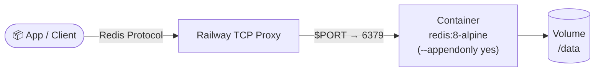

# Redis for railway.app


Redis is an open-source, in-memory data store used as a database, cache, message broker, and queue, prized for its speed and simple key-value model with support for richer structures like lists, sets, and hashes. This template deploys Redis 8 on Railway using the official Docker image, with append-only persistence and password authentication enabled by default.

[](https://railway.com/deploy/redis-2?referralCode=2_sIT9&utm_medium=integration&utm_source=template&utm_campaign=generic)

## 🏗️ Architecture



## Environment variables

```bash
REDIS_PASSWORD=replace-with-strong-password
```

`REDIS_PASSWORD` is required. The server is started with `--requirepass "$REDIS_PASSWORD"`, so Redis will not accept unauthenticated connections — set it as a generated secret in the Railway dashboard before deploying. Clients must authenticate with `AUTH <password>` (or `redis-cli -a <password>`).

## Persistence

`railway.toml` declares `requiredMountPath = "/data"` for AOF/RDB files (append-only is enabled). Attach a Railway volume to that path before production traffic — Railway will prompt for it based on this setting, but it is not created automatically.

## Health check

The Dockerfile defines a `HEALTHCHECK` that runs `redis-cli -a "$REDIS_PASSWORD" ping` on an interval, since Redis has no HTTP endpoint to probe.

## Upgrading from Redis 7.x to 8

Template releases from `0.2.0` on ship Redis 8 (`redis:8.x-alpine`); `0.1.x` shipped Redis 7.4. Existing volumes need no migration. On first start, Redis 8 loads the existing AOF/RDB files from `/data` as they are. This was tested with 7.4.12 → 8.10.3 using AOF (base RDB + incremental AOF): strings, hashes incl. per-field TTLs (`HEXPIRE`), lists, sets, sorted sets, streams, HyperLogLog, bitmaps and key TTLs were preserved.

Recommended steps:

1. Take a backup first: run `redis-cli -a "$REDIS_PASSWORD" BGSAVE`, then copy `/data` (or create a Railway volume backup).
2. Deploy the new template version and check `redis-cli -a "$REDIS_PASSWORD" INFO server | grep redis_version` and `DBSIZE`.

### Downgrade warning

**You cannot go back from 8 to 7.4 with the same volume.** As soon as Redis 8 rewrites its files (AOF rewrite, `BGSAVE`, or a regular snapshot), it writes RDB format version 15. Redis 7.4 refuses to start with `Can't handle RDB format version 15`. That is a startup error and it does not touch the data, but you would need to roll forward to 8 again. If you must stay on 7.4, keep the volume backup from step 1 and pin template release `0.1.x` (`FROM redis:7.4.12-alpine`).

### Licensing change

Redis 7.4 is available under RSALv2 or SSPLv1. From Redis 8.0, Redis is **tri-licensed: AGPLv3, RSALv2 or SSPLv1**, and you choose one. Running it unmodified as the database of your own application is normally fine under any of them. If you offer Redis itself as a service to third parties, or modify and distribute it, check the obligations of the license you pick (for example, AGPLv3 §13 source-offer requirements). See [redis.io/legal/licenses](https://redis.io/legal/licenses/). This template only contains the official image and a start command; the template files in this repository keep their own license.

## Local

```bash
docker build -t railwayapp-redis .
docker run --rm -e REDIS_PASSWORD=dev-password -p 6379:6379 railwayapp-redis
```

## 💬 Support

Questions or feedback? Visit the [template forum on Railway Central Station](https://station.railway.com/templates/redis-823f8407).

<!-- footer -->
---

[](https://github.com/vergissberlin/railwayapp-airbyte) [](https://github.com/vergissberlin/railwayapp-airflow) [](https://github.com/vergissberlin/railwayapp-cloudbeaver-ce) [](https://github.com/vergissberlin/railwayapp-codimd) [](https://github.com/vergissberlin/railwayapp-django) [](https://github.com/vergissberlin/railwayapp-email) [](https://github.com/vergissberlin/railwayapp-fastapi) [](https://github.com/vergissberlin/railwayapp-flask) [](https://github.com/vergissberlin/railwayapp-flowise) [](https://github.com/vergissberlin/railwayapp-gitlab) [](https://github.com/vergissberlin/railwayapp-grafana) [](https://github.com/vergissberlin/railwayapp-homeassistant) [](https://github.com/vergissberlin/railwayapp-influxdb) [](https://github.com/vergissberlin/railwayapp-mjml) [](https://github.com/vergissberlin/railwayapp-mongodb) [](https://github.com/vergissberlin/railwayapp-mqtt) [](https://github.com/vergissberlin/railwayapp-mysql) [](https://github.com/vergissberlin/railwayapp-n8n) [](https://github.com/vergissberlin/railwayapp-nodejs) [](https://github.com/vergissberlin/railwayapp-nodered) [](https://github.com/vergissberlin/railwayapp-opensearch) [](https://github.com/vergissberlin/railwayapp-openwebui) [](https://github.com/vergissberlin/railwayapp-operately) [](https://github.com/vergissberlin/railwayapp-outerbase-studio) [](https://github.com/vergissberlin/railwayapp-postgresql) [](https://github.com/vergissberlin/railwayapp-redis) [](https://github.com/vergissberlin/railwayapp-typo3)
